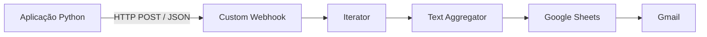
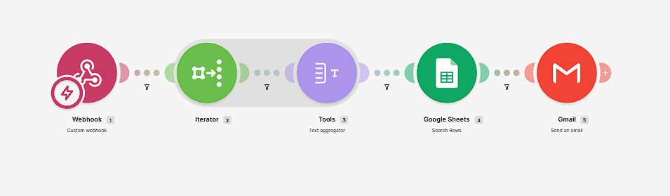
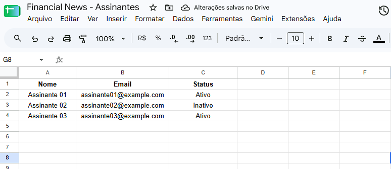

# Integração com o Make --- Financial News Lab

## 1. Objetivo

O Make é a camada de automação responsável pela distribuição do boletim financeiro produzido pela aplicação Python. O cenário recebe os dados estruturados, formata as notícias em HTML, consulta uma base de assinantes e envia mensagens personalizadas por e-mail.

A separação entre geração de conteúdo e distribuição permite evoluir a automação sem modificar necessariamente a lógica dos agentes de IA.

## 2. Arquitetura





  Módulo                             Responsabilidade
  ---------------------------------- ---------------------------------------------
  1 --- Custom Webhook               Receber o boletim em JSON.
  2 --- Iterator                     Separar as notícias em bundles individuais.
  3 --- Text Aggregator              Consolidar as notícias em HTML.
  4 --- Google Sheets: Search Rows   Selecionar assinantes ativos.
  5 --- Gmail: Send an Email         Distribuir o boletim personalizado.

## 3. Contrato de integração

A aplicação envia o boletim ao webhook por meio de uma requisição HTTP POST. O payload contém um objeto com o array `noticias`, estruturado pelos modelos Pydantic da aplicação.

Exemplo ilustrativo:

``` json
{
  "noticias": [
    {
      "titulo": "Título da notícia",
      "resumo": "Resumo da notícia em português.",
      "fonte": "BBC Business",
      "data": "Fri, 27 Nov 2026 10:00:00 GMT",
      "link": "https://example.com/noticia"
    }
  ]
}
```

  Campo    Tipo     Finalidade
  -------- -------- ----------------------------------
  titulo   string   Título da notícia.
  resumo   string   Síntese em português.
  fonte    string   Identificação da fonte original.
  data     string   Data de publicação original.
  link     string   Endereço da publicação original.

O campo `data` é recebido pelo Make, mas não é exibido individualmente nos cards da versão atual. A data no cabeçalho do boletim corresponde à data de execução do cenário.

## 4. Configuração dos módulos

### 4.1. Webhooks --- Custom Webhook

-   Nome: `Financial News - Receber Boletim`.
-   Estrutura de entrada: array `noticias`, com os cinco campos descritos anteriormente.
-   Maximum number of results: `1`.

O webhook é o ponto de entrada do cenário. Sua URL é configurada na variável de ambiente `MAKE_WEBHOOK_URL` da aplicação Python.

### 4.2. Iterator

O Iterator transforma cada elemento do array em um bundle individual, permitindo acessar os campos de cada notícia separadamente.

  Parâmetro   Mapeamento
  ----------- ------------------
  Array       `{{1.noticias}}`

### 4.3. Tools --- Text Aggregator

O agregador utiliza o Iterator (módulo 2) como origem. Cada bundle é formatado como um card HTML e os cards são reunidos em um único texto, sem separador adicional.

  Elemento do card   Mapeamento
  ------------------ ----------------
  Fonte              `{{2.fonte}}`
  Título             `{{2.titulo}}`
  Resumo             `{{2.resumo}}`
  Link original      `{{2.link}}`

O template utiliza estilos CSS inline. O resultado consolidado fica disponível em `{{3.text}}` para o módulo Gmail. Essa agregação evita que seja enviado um e-mail separado para cada notícia.

### 4.4. Google Sheets --- Search Rows

A planilha `Financial News - Assinantes`, aba `Página1`, funciona como base simplificada de assinantes.

  Coluna   Campo    Finalidade
  -------- -------- ---------------------------------------------
  A        Nome     Personalização da saudação.
  B        Email    Endereço do destinatário.
  C        Status   Controle de elegibilidade para recebimento.



A imagem apresenta exclusivamente dados fictícios.

  Configuração             Valor
  ------------------------ ---------------------------------
  Search Method            Select from My Drive
  Table contains headers   Yes
  Column range             A--CZ
  Filtro                   Coluna C --- Equal to --- Ativo
  Limit                    10

O módulo retorna até dez registros ativos por consulta. Cada linha retornada gera um bundle para o módulo Gmail. Registros inativos não são selecionados. Não há ordenação explícita por coluna configurada.

### 4.5. Gmail --- Send an Email

  Configuração         Valor
  -------------------- ------------------------------------------------------
  Destinatário         `` {{4.`1`}} `` (coluna B)
  Saudação             `` {{4.`0`}} `` (coluna A)
  Assunto              Financial News \| Boletim diário
  Body type            Raw HTML
  Notícias agregadas   `{{3.text}}`
  Data                 `formatDate(now; "DD/MM/YYYY"; "America/Sao_Paulo")`

O template HTML inclui identidade visual, saudação personalizada, data de execução, cards das notícias, links para as fontes e avisos sobre o uso de inteligência artificial e a natureza informativa do conteúdo.

Cada registro elegível recebe uma mensagem individual.

## 5. Resultado visual

O exemplo abaixo apresenta o layout do boletim, com cinco notícias e saudação de teste. O conteúdo é uma amostra da saída da aplicação, não uma verificação independente das notícias.


## 6. Reprodução do cenário

O [Blueprint sanitizado](integrations/make/financial-news.make.blueprint.json) disponibiliza a estrutura dos módulos, mapeamentos e templates HTML.

### Pré-requisitos

-   Conta no Make.
-   Conta Google com acesso ao Sheets e ao Gmail.
-   Aplicação Python configurada com suas dependências e variáveis de ambiente.
-   Planilha de assinantes com os cabeçalhos `Nome`, `Email` e `Status`, nessa ordem.

### Importação e configuração

1.  Crie um novo cenário no Make e utilize a opção **Import blueprint** para importar o JSON.
2.  No Custom Webhook, crie um novo webhook e copie sua URL.
3.  No Google Sheets, configure sua própria conexão, selecione a planilha e a aba correspondente e confira o filtro `Status = Ativo` e o limite de dez registros.
4.  No Gmail, configure sua própria conexão e confira os mapeamentos do destinatário, da saudação e do HTML agregado.
5.  Salve o cenário e confira se todos os módulos estão configurados.
6.  No arquivo `.env` da aplicação Python, preencha a variável abaixo com a URL do novo webhook, mantendo as demais variáveis necessárias ao projeto.

``` dotenv
MAKE_WEBHOOK_URL=
```

O Blueprint não substitui a configuração das conexões e dos recursos de cada conta. A importação da versão sanitizada ainda precisa ser validada em um novo cenário.

## 7. Execução

### Execução manual

1.  Ative o ambiente virtual e execute, na raiz do projeto:

    ``` bash
    python main.py
    ```

2.  Aguarde a geração e o envio do boletim ao webhook.

3.  No Make, execute o cenário com **Run once**.

4.  Caso existam dados aguardando processamento, selecione **Use existing data** para processar o payload já recebido. Alternativamente, coloque o cenário em espera e execute o Python para enviar novos dados.

5.  Acompanhe os bundles processados pelos módulos e confira o recebimento do e-mail em uma conta de teste.

### Execução automática

O cenário pode ser ativado e configurado para execução imediata após a chegada de dados ao webhook (**Immediately as data arrives**). Essa modalidade ainda não foi validada no projeto.

A execução periódica do Python é independente do agendamento do Make. O nome "Boletim diário" descreve a proposta do produto, não comprova que exista um agendamento diário ativo.

## 8. Validação e monitoramento

  ------------------------------------------------------------------------------------------
  Verificação                                         Situação
  --------------------------------------------------- --------------------------------------
  Envio do payload pelo Python                        Validado manualmente

  Recebimento pelo webhook                            Validado manualmente

  Processamento do cenário                            Validado manualmente

  Geração e recebimento do boletim HTML               Evidenciado pelo exemplo de execução

  Exclusão de assinantes inativos em teste dedicado   Pendente de validação específica

  Importação do Blueprint sanitizado                  Pendente

  Execução automática                                 Pendente

  Tratamento de falhas e reenvios no Make             Pendente
  ------------------------------------------------------------------------------------------

Em caso de falha, consultar os logs da aplicação Python e o histórico de execução do cenário no Make. Verificar o payload recebido, a configuração das conexões, os registros retornados pela planilha e o resultado do módulo Gmail.

O aceite de uma requisição pelo webhook não comprova, por si só, que todos os e-mails foram entregues.

## 9. Segurança e privacidade

-   Manter a URL do webhook e as chaves de API no `.env`, fora do controle de versão.
-   Manter as conexões Google configuradas diretamente no Make.
-   Não publicar dados reais dos assinantes, credenciais ou identificadores privados dos recursos.
-   Utilizar dados fictícios nas evidências públicas e revisar o Blueprint antes de compartilhar.
-   Restringir o acesso à planilha e utilizar destinatários autorizados durante os testes.

## 11. Organização dos arquivos

``` text
financial-news-lab/
├── MAKE.md
└── integrations/
    └── make/
        ├── financial-news.make.blueprint.json
        └── images/
            ├── make-scenario.png
            ├── subscribers-example.png
            └── newsletter-preview.png
```

A documentação descreve o cenário implementado e distingue os recursos existentes das melhorias propostas.
