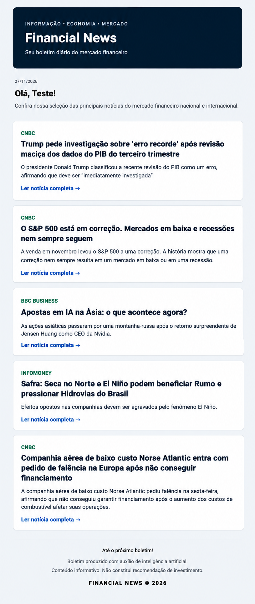
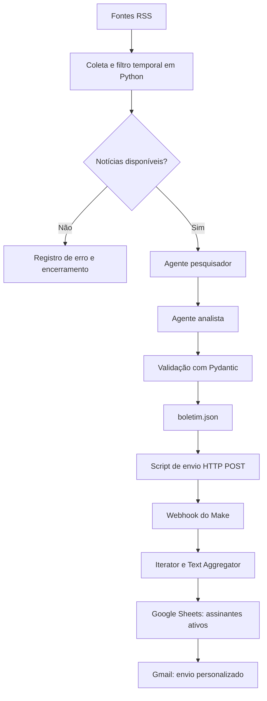
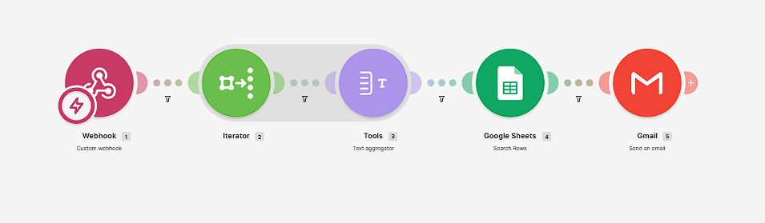

# Financial News Lab

Automação de boletins de notícias financeiras com inteligência artificial, arquitetura multiagente e distribuição por e-mail.

## Sobre o projeto

O Financial News Lab é um projeto de portfólio que explora a aplicação de inteligência artificial à curadoria de informações financeiras. A solução coleta notícias de fontes nacionais e internacionais, seleciona acontecimentos relevantes, produz resumos em português e disponibiliza um boletim para distribuição automatizada por e-mail.

O objetivo é reduzir o esforço manual de pesquisa, seleção e preparação de conteúdo financeiro, integrando agentes de IA a ferramentas de automação e mecanismos de validação e monitoramento.

## Resultado final



## Funcionalidades

-   Coleta de notícias via RSS da BBC Business, CNBC e InfoMoney.
-   Filtro temporal de publicações das últimas 24 horas.
-   Seleção de até cinco notícias por relevância, com instruções para evitar duplicidades e diversificar assuntos e fontes.
-   Tradução de títulos e produção de resumos em português do Brasil.
-   Saída estruturada e validada com Pydantic, armazenada em JSON.
-   Registro de eventos, avisos e exceções em logs.
-   Integração HTTP com o Make para distribuição do boletim.
-   Consulta de assinantes ativos no Google Sheets e envio de e-mails personalizados pelo Gmail.

## Arquitetura



A geração do boletim e o envio ao Make são executados por scripts independentes. Essa separação permite reutilizar o JSON gerado sem executar novamente os agentes.

### Agentes de inteligência artificial

  ----------------------------------------------------------------------------------------------------------------
  Agente                              Responsabilidade
  ----------------------------------- ----------------------------------------------------------------------------
  Pesquisador                         Selecionar notícias relevantes entre os dados previamente coletados.

  Analista                            Traduzir títulos, sintetizar informações e produzir o boletim estruturado.
  ----------------------------------------------------------------------------------------------------------------

A orquestração é sequencial, utilizando o resultado da tarefa de pesquisa como contexto para a tarefa de análise. Ambos os agentes utilizam o modelo `gpt-4o-mini`, com temperatura de 0,2.

### Integração com o Make



O cenário recebe o boletim via webhook, transforma as notícias em conteúdo HTML, consulta os assinantes ativos e envia a newsletter por e-mail.

## Decisões técnicas

**Controle da coleta e confiabilidade:** a implementação inicial utilizava tool calling para disponibilizar a coleta RSS ao agente pesquisador. Durante testes de indisponibilidade das fontes, foram observadas respostas sem respaldo nos dados coletados. A coleta passou a ser executada diretamente pelo Python, com verificação da disponibilidade de notícias antes da execução dos agentes.

**Engenharia de prompts:** as instruções foram refinadas para orientar relevância, diversidade, deduplicação, tradução contextualizada e preservação das informações originais, sem recomendações de investimento.

**Validação estruturada:** os modelos Pydantic estabelecem os campos obrigatórios, as fontes permitidas, o prefixo HTTP/HTTPS dos links e o limite de cinco notícias. A aplicação também verifica se o boletim está vazio antes de salvá-lo. Essas verificações são estruturais e não constituem uma verificação factual independente.

**Observabilidade e resiliência:** logs acompanham a consulta às fontes, a execução dos agentes e o armazenamento do boletim. Testes manuais com falhas simuladas orientaram o tratamento de exceções e a continuidade da coleta quando uma fonte não retorna notícias.

## Stack tecnológica

  Tecnologia      Aplicação
  --------------- ----------------------------------------
  Python          Coleta, processamento e integração
  CrewAI          Orquestração multiagente
  OpenAI          Modelo de linguagem GPT-4o mini
  Feedparser      Leitura de feeds RSS
  Pydantic        Validação e serialização de dados
  Requests        Requisições HTTP
  python-dotenv   Configuração por variáveis de ambiente
  Logging         Registro de eventos e falhas
  Make            Automação da distribuição
  Google Sheets   Gestão de assinantes
  Gmail           Envio de newsletters
  Git e GitHub    Versionamento e documentação

## Estrutura do projeto

``` text
financial-news-lab/
├── integrations/
│   └── make/
│       ├── financial-news.make.blueprint.json
│       └── images/
│           ├── make-scenario.png
│           ├── newsletter-preview.png
│           └── subscribers-example.png
├── .env.example
├── .gitignore
├── AGENTES.md
├── MAKE.md
├── README.md
├── enviar_boletim.py
├── main.py
├── noticias.py
├── requirements.txt
└── schemas.py
```

## Instalação e execução

### 1. Preparar o ambiente

Pré-requisitos: Python, Git, acesso à API da OpenAI e, para a distribuição por e-mail, uma conta no Make com conexões ao Google Sheets e Gmail.

No PowerShell, a partir da raiz do repositório:

``` powershell
python -m venv .venv
.\.venv\Scripts\Activate.ps1
pip install -r requirements.txt
```

### 2. Configurar as variáveis de ambiente

``` powershell
Copy-Item .env.example .env
```

Preencha o arquivo `.env` com suas próprias credenciais:

``` dotenv
OPENAI_API_KEY=
MAKE_WEBHOOK_URL=
```

Não compartilhe o arquivo `.env` nem publique credenciais no repositório.

### 3. Gerar o boletim

``` powershell
python main.py
```

Uma execução bem-sucedida gera o arquivo `boletim.json`. Os registros da aplicação ficam em `app.log`.

### 4. Configurar a distribuição

Importe o [blueprint do Make](integrations/make/financial-news.make.blueprint.json), configure o webhook, a planilha de assinantes e as conexões do Google Sheets e Gmail. Consulte o [guia de integração](MAKE.md) para os detalhes.

Com um boletim gerado e o webhook configurado, execute:

``` powershell
python enviar_boletim.py
```

O script envia o JSON ao Make e apresenta o código HTTP e a resposta recebida. O processamento depende da configuração de execução do cenário.

## Documentação complementar

-   [Arquitetura dos agentes e decisões técnicas](AGENTES.md)
-   [Integração e cenário de automação no Make](MAKE.md)
-   [Blueprint do cenário](integrations/make/financial-news.make.blueprint.json)

------------------------------------------------------------------------

Projeto desenvolvido para fins de aprendizado e portfólio. Os resumos são produzidos com auxílio de inteligência artificial e não constituem recomendações de investimento.
